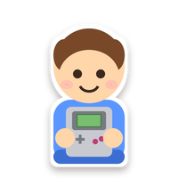

# KidsOS for the Miyoo Mini Plus



A Miyoo Mini Plus for small kids. Turn it on, pick a game, play. Nothing else.

KidsOS is [Onion](https://onionui.github.io/) with a different start screen. Onion still does all the real
work: emulators, save states, Wi-Fi, box art.

<p align="center">
  
</p>

## What the kid sees

A row of big game pictures. Left and right to pick one, **A** to play, **MENU** to stop. That's it. No
menus, no settings, nothing to read.

<p align="center">
  
  
</p>

A game that was played before asks one question with two pictures: continue where you left off, or start
over.

<p align="center">
  
  
</p>

Pressing MENU in a game saves it and goes back to the row. Next time the game offers to continue from
there.

## What the parent gets

- **You choose the games.** The kid's row is Onion's favourites list. Add a game to the favourites, it
  shows up. Remove it, it's gone.
- **Box art comes by itself.** With Wi-Fi on, the console downloads a picture for every game in the row.
- **A way out.** Hold **SELECT + START** for three seconds and Onion's normal menu appears. A bar fills up
  while you hold, so random button mashing by the kid does nothing.
- **Arcade coins.** Arcade games get a number of coins per day. SELECT inserts one. When they're used up,
  the game keeps running but SELECT stops working until the next day.
- **No time limit.** On purpose, see [below](#no-time-limit).

<p align="center">
  
</p>

| Button | What it does |
|--------|--------------|
| Left / Right | Pick a game |
| A | Play |
| MENU (in a game) | Save and go back to the row |
| SELECT (arcade games) | Insert a coin |
| Volume + / - | Volume |
| SELECT + START, hold 3 s | Parent: open Onion's menu |

## No time limit

KidsOS has no "maximum play time per day" and won't get one.

How long a kid plays is something the kid and the parents agree on. If the console enforces it, the console
becomes the one who says stop, and the kid argues with a device instead of learning to stop. "One more
level, then we put it away" is the limit. The console only has to make putting it away easy: MENU saves,
Continue brings it back.

Arcade coins are a different thing. They work like a real arcade: a few coins are the budget, when they're
gone the game ends. The kid can still play something else.

> **Early version.** The launcher runs on a real Miyoo Mini Plus. The zip below has only been tested in an
> emulated boot. If something goes wrong, see [Troubleshooting](#troubleshooting). KidsOS only writes to the
> SD card, never to the console itself.

## Installation

You need:

- A **Miyoo Mini Plus**. The original Miyoo Mini should work too, but I haven't tried it.
- A **microSD card**, 32 GB or more, from a known brand. The card that comes with the console is slow and
  unreliable.
- A computer with a card reader.
- Game files (ROMs) for the systems you want.

It takes about fifteen minutes, most of it waiting.

### 1. Format the card as FAT32

- **Mac:** open Disk Utility, select the card itself (the top entry, not the volume under it), click
  *Erase*, pick *MS-DOS (FAT)* and *Master Boot Record*, click *Erase*.
- **Windows:** for cards over 32 GB use [Rufus](https://rufus.ie/): Boot selection *Non bootable*, File
  system *Large FAT32*, then *Start*.

### 2. Copy KidsOS to the card

1. Download the latest `KidsOS-x.y.z.zip` from the
   [releases page](https://github.com/coorasse/onionKidsOS/releases).
2. Unzip it. You get seven folders and two small text files.
3. Copy **all of it** to the root of the card. One folder, `.tmp_update`, is hidden. On a Mac press
   `Cmd + Shift + .` in the Finder to show hidden files, on Windows turn on *Hidden items* in the *View*
   menu. Without that folder nothing happens.

### 3. First start

1. Put the card in the console and turn it on. Onion installs itself. This takes a few minutes.
2. A short guide to Onion appears. Go through it with **A**.
3. The *Package Manager* appears with a list of systems. Press **A** on the ones you have games for (for
   example *Game Boy*, *SNES*, *PlayStation*), then press **START** twice.
4. The console reboots into the kids screen. It's empty, because no games are chosen yet.

### 4. Add games

1. Turn the console off and put the card back in the computer.
2. Copy your game files into `Roms/<SYSTEM>/`. The folder names are short codes: `GB` (Game Boy), `GBC`
   (Game Boy Color), `GBA` (Game Boy Advance), `FC` (NES), `SFC` (SNES), `PS` (PlayStation). The full list
   is in [Onion's docs](https://onionui.github.io/docs/emulators/folders).
3. Put the card back and turn the console on.
4. Hold **SELECT + START** for three seconds. Onion's menu appears and stays until you turn the console
   off, or until you open **KidsOS** in the *Apps* tab and pick *Back to the kids screen*.
5. In *Games*, open a system, go to a game, press **SELECT** and pick *Add to favorites*. Do this for every
   game the kid may play.
6. Turn the console off and on. The games are in the row.

To remove a game, do the same and pick *Remove from favorites*.

### Pictures for the games

Turn on Wi-Fi once: hold **SELECT + START**, open *Apps* › *Tweaks* › *Network*, turn Wi-Fi on and pick
your network. From then on the console downloads missing pictures every time the kids screen comes up. They
appear within a minute. Without Wi-Fi the tiles show the game's name.

The pictures come from [libretro thumbnails](https://thumbnails.libretro.com/) and are looked up by file
name. `Tetris.gb` and `Tetris (World) (Rev 1).gb` work, `tetris_final_v2.gb` doesn't. If a game gets no
picture, rename the file to the game's real title.

To use your own picture, put a PNG with the same name as the game file in `Roms/<SYSTEM>/Imgs/`. For
example `Roms/GB/Tetris.gb` and `Roms/GB/Imgs/Tetris.png`.

## Arcade coins

Games in the arcade folders (ARCADE, NEOGEO, CPS and so on) get 10 coins a day. Every SELECT press in a
game uses one. A counter in the top left corner of the kids screen shows how many are left. When they're
gone the game keeps its credits and goes on, SELECT just does nothing anymore, the counter turns grey and
the arcade tiles fade. The next day the coins are back. The console has no clock of its own, so without
Wi-Fi "the next day" means the next time it's turned on.

To change the number on the console: hold **SELECT + START**, open the *Apps* tab and start **KidsOS**. You
can set the coins per day (3 to 30, or no limit), hand out today's coins again, and go back to the kids
screen.

Or edit `kids/settings.txt` at the root of the card with a text editor. The file is created the first time
KidsOS starts and looks like this:

```
# Arcade coins the kid may insert per day (0 = unlimited).
arcade_coins_per_day=10
# Systems whose games use coins, by folder tag.
arcade_systems=ARCADE,CPS1,CPS2,CPS3,NEOGEO,FBN,FBNEO,MAME
```

`arcade_coins_per_day=0` turns coins off: no counter, SELECT always works. The second line is the list of
folders that count as arcade. To hand out today's coins again from the computer, delete `kids/coins.txt`.

## Other settings

Everything else, including the emulator's own menu, is out of the kid's reach. After SELECT + START you can
change brightness, theme music, Wi-Fi and so on in *Apps* › *Tweaks*, like on plain Onion.

## Updating

Download the new zip, copy the folders onto the card over the old ones (replace when asked), put the card
back and turn the console on. Onion updates itself and keeps games, saves and favourites.

Don't use Onion's own *OTA update* app. It would install plain Onion and the kids screen would be gone.
Copying a KidsOS zip onto the card brings it back.

## Going back to plain Onion

Download [Onion](https://github.com/OnionUI/Onion/releases), copy its folders onto the card the same way,
and delete the hidden folder `.kidsos`. Games and saves stay.

## Troubleshooting

- **Onion's boot picture instead of the KidsOS one.** Harmless, the kids screen still comes up. Copying the
  KidsOS zip onto the card again fixes it.
- **Black screen, nothing reacts.** Hold **POWER** until the console is off, then turn it on again.
- **The kids screen is empty.** No favourites yet, see [Add games](#4-add-games).
- **The console starts into Onion's menu.** Copy the KidsOS zip onto the card again, see
  [Copy KidsOS to the card](#2-copy-kidsos-to-the-card).
- **A game has no picture.** Check that Wi-Fi is on and that the file is named after the game.
  `.kidsos/covers.log` on the card says what was tried.
- **A game doesn't start.** Try it from Onion's menu (SELECT + START). If it doesn't start there either,
  the problem is the game file or the emulator, not KidsOS.

## How it works

Onion lives on the SD card, the console's own firmware only starts it. KidsOS adds a small launcher to
Onion's package and a boot hook that puts it in front of Onion's menu. Onion's own scripts aren't changed,
so Onion keeps working as documented and copying a new KidsOS zip onto the card always brings the kids
screen back. Build instructions and the development setup are in
[docs/DEVELOPMENT.md](docs/DEVELOPMENT.md).

KidsOS is free software under the [GPL-3.0](LICENSE), like Onion. It has nothing to do with Miyoo or the
Onion team.
