<p align="center">
  <picture>
    <source media="(prefers-color-scheme: dark)" srcset="docs/images/logo-cream.png">
    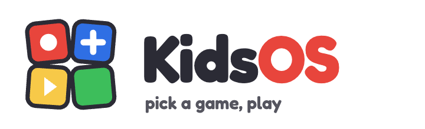
  </picture>
</p>

# KidsOS for the Miyoo Mini Plus

A Miyoo Mini Plus for small kids. Turn it on, pick a game, play. Nothing else.

KidsOS is [Onion](https://onionui.github.io/) with a different start screen. Onion still does all the real
work: emulators, save states, Wi-Fi, box art.

<p align="center">
  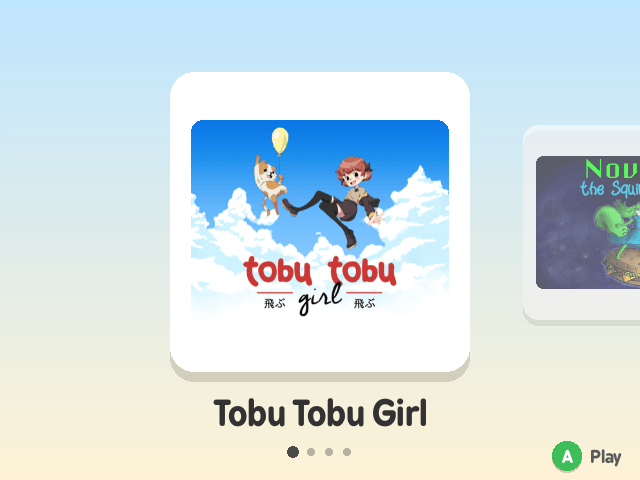
</p>

Check this video on YouTube:

<p align="center">
  <a href="https://youtu.be/9jOx8kLye9k">
    
  </a>
</p>

## What the kids see

A row of big game pictures. Left and right to pick one, **A** to play, **MENU** to stop. That's it. No
menus, no settings, nothing to read.

<p align="center">
  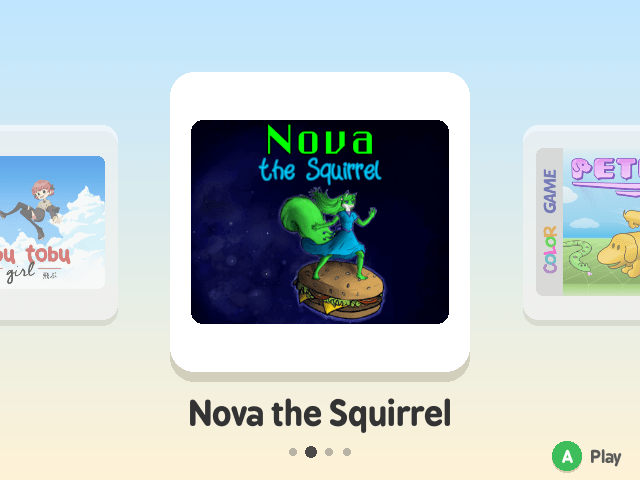
  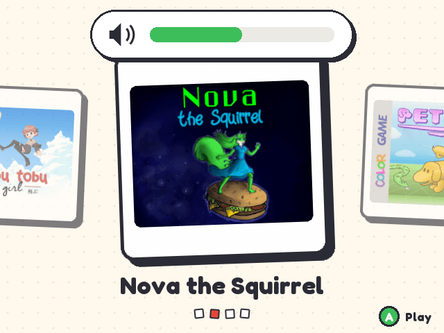
</p>

A game that was played before asks one question with two pictures: continue where you left off, or start
over.

<p align="center">
  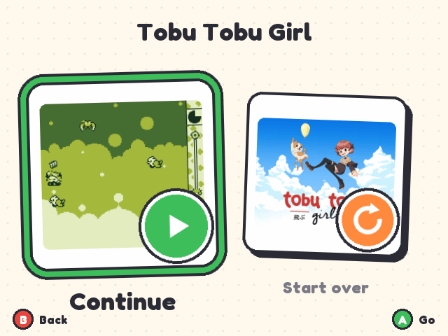
  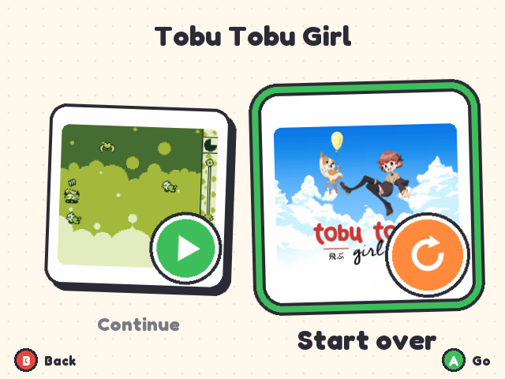
</p>

Pressing MENU in a game saves it and goes back to the row. Next time the game offers to continue from
there.
POWER saves too and switches the console off; at the next power on the game is back where it was.
On the Miyoo Mini Flip, closing the lid does the same.

## What the parent gets

- **You choose the games.** The kid's row is Onion's favourites list. Add a game to the favourites, it
  shows up. Remove it, it's gone.
- **Box art comes by itself.** With Wi-Fi on, the console downloads a picture for every game in the row.
- **A way out.** Hold **SELECT + START** for three seconds and Onion's normal menu appears. A bar fills up
  while you hold, so random button mashing by the kid does nothing.
- **Arcade coins.** Arcade games get a number of coins per day. SELECT inserts one. When they're used up,
  the game keeps running but SELECT stops working until the next day.
- **No time limit.** On purpose, see [below](#no-time-limit).

<p align="center">
  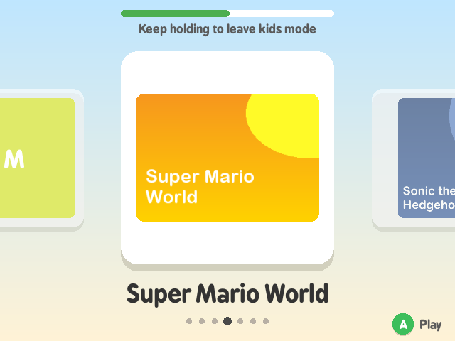
</p>

Behind it is plain Onion in the KidsOS colours. The *Apps* tab has a **KidsOS** entry with the few
things a parent needs: back to the kids screen and the arcade coins.

<p align="center">
  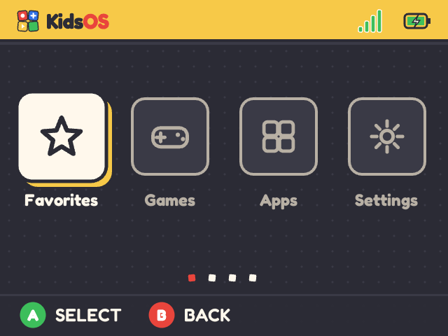
  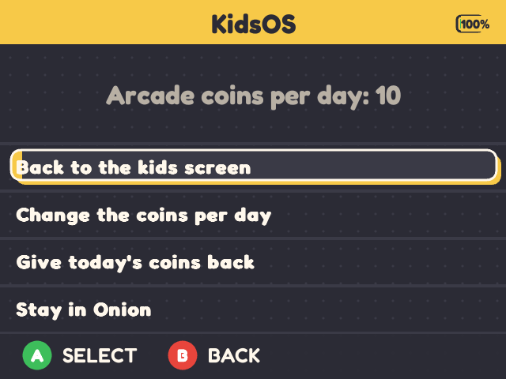
</p>

| Button | What it does |
|--------|--------------|
| Left / Right | Pick a game |
| A | Play |
| MENU (in a game) | Save and go back to the row |
| POWER, or closing the lid (Mini Flip) | Save and switch off |
| SELECT (arcade games) | Insert a coin |
| Volume + / - | Volume |
| SELECT + START, hold 3 s | Parent: open Onion's menu |

## No time limit

KidsOS has no "maximum play time per day" and won't get one.

How long a kid plays is something the kid and the parents agree on. If the console enforces it, the console
becomes the one who says stop, and the kid argues with a device instead of learning to stop.

"One more level, then we put it away" is the limit.

The console only has to make putting it away easy: MENU saves, Continue brings it back.

Arcade coins are a different thing. They work like a real arcade: a few coins are the budget, when they're
gone the game ends. The kid can still play something else.

The better they get, the longer they can play.


## Installation

You need:

- A **Miyoo Mini Plus**. The original Miyoo Mini should work too, but I haven't tried it.
- A **microSD card**, 32 GB or more, from a known brand. The card that comes with the console is slow and
  unreliable.
- A computer with a card reader.
- Game files (ROMs) for the systems you want.
- Ten minutes

### 1. Put KidsOS on the card

Put the card in the reader, open a terminal (on a Mac: *Terminal* in *Applications › Utilities*) and paste
this line:

```bash
curl -fsSL https://raw.githubusercontent.com/coorasse/onionKidsOS/main/install.sh | sh
```

The installer asks a few questions and does the rest:

1. It finds the card and shows it to you. If you have more than one card in the computer, you choose which one.
2. A new card gets erased, so you type the card's name to go on. Nothing is erased before that. A card that
   already has KidsOS or Onion can be updated instead, see [Updating](#updating).
3. It asks the language of the console and your Wi-Fi network. With Wi-Fi the console finds a picture for
   every game by itself. Press Enter to skip Wi-Fi.
4. It asks which KidsOS version you want. Press Enter for the newest.
5. It downloads KidsOS, formats the card and copies everything over. When it says *All done*, take the card
   out.

**Ctrl-C** stops it at any time. It works on Mac and Linux; Linux asks for your password to format the card.
A Windows script is on the way, until then use the steps by hand below.

**Options.** Put them after `sh -s --`, for example:

```bash
curl -fsSL https://raw.githubusercontent.com/coorasse/onionKidsOS/main/install.sh | sh -s -- --zip ~/Downloads/KidsOS-0.2.0.zip
```

- `--zip FILE` uses a KidsOS zip you already have instead of downloading one.
- `--disk NAME` says which card to use instead of looking for it: `disk4` on a Mac (see `diskutil list`),
  `/dev/sdb` or `/dev/mmcblk0` on Linux. It still asks before erasing anything.

<details>
<summary>By hand instead</summary>

1. Format the card as FAT32. **Mac:** open Disk Utility, select the card itself (the top entry, not the
   volume under it), click *Erase*, pick *MS-DOS (FAT)* and *Master Boot Record*, click *Erase*. **Windows:**
   for cards over 32 GB use [Rufus](https://rufus.ie/): Boot selection *Non bootable*, File system *Large
   FAT32*, then *Start*.
2. Download the latest `KidsOS-x.y.z.zip` from the
   [releases page](https://github.com/coorasse/onionKidsOS/releases) and unzip it. You get seven folders and
   three files.
3. Copy **all of it** to the root of the card. One folder, `.tmp_update`, is hidden. On a Mac press
   `Cmd + Shift + .` in the Finder to show hidden files, on Windows turn on *Hidden items* in the *View*
   menu. Without that folder nothing happens.

</details>

### 2. First start

1. Put the card in the console and turn it on. KidsOS installs itself in about two minutes. There is nothing
   to press.
2. The console reboots into the kids screen. It's empty, because no games are chosen yet.

Game Boy, Game Boy Color, Game Boy Advance, NES, SNES, Nintendo DS and Neo Geo are ready out of the box. For
other systems (for example *PlayStation*) open *Apps* › *Package Manager* in Onion's menu later.

### 3. Add games

1. Turn the console off and put the card back in the computer.
2. Copy your game files into `Roms/<SYSTEM>/`. The folder names are short codes: `GB` (Game Boy), `GBC`
   (Game Boy Color), `GBA` (Game Boy Advance), `FC` (NES), `SFC` (SNES), `NDS` (Nintendo DS), `PS`
   (PlayStation), `FBNEO` (arcade). The full list is in
   [Onion's docs](https://onionui.github.io/docs/emulators/folders).
3. Put the card back and turn the console on.
4. Hold **SELECT + START** for three seconds. Onion's menu appears and stays until you turn the console
   off, or until you open **KidsOS** in the *Apps* tab and pick *Back to the kids screen*.
5. In *Games*, open a system, go to a game, press **SELECT** and pick *Add to favorites*. Do this for every
   game the kid may play.
6. Turn the console off and on. The games are in the row.

To remove a game, do the same and pick *Remove from favorites*.

<p align="center">
  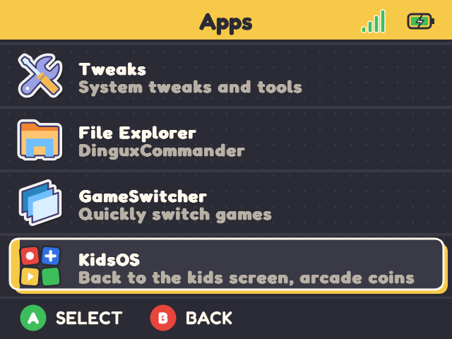
</p>

### Pictures for the games

If you gave the installer your Wi-Fi network, this is already done. Otherwise turn on Wi-Fi once: hold
**SELECT + START**, open *Apps* › *Tweaks* › *Network*, turn Wi-Fi on and pick
your network. From then on the console downloads missing pictures every time the kids screen comes up. They
appear within a minute. Without Wi-Fi the tiles show the game's name.

The pictures come from [libretro thumbnails](https://thumbnails.libretro.com/) and are looked up by file
name. `Tetris.gb` and `Tetris (World) (Rev 1).gb` work, `tetris_final_v2.gb` doesn't. If a game gets no
picture, rename the file to the game's real title.

To use your own picture, put a PNG with the same name as the game file in `Roms/<SYSTEM>/Imgs/`. For
example `Roms/GB/Tetris.gb` and `Roms/GB/Imgs/Tetris.png`.

## Arcade coins

Games in the arcade folders (ARCADE, NEOGEO, CPS and so on) get 10 coins a day. Every SELECT press in a
game uses one. A counter in the top left corner of the kids screen shows how many are left. When they're
gone the game keeps its credits and goes on, SELECT just does nothing anymore, the counter turns grey and
the arcade tiles fade. The next day the coins are back. The console has no clock of its own, so without
Wi-Fi "the next day" means the next time it's turned on.

To change the number on the console: hold **SELECT + START**, open the *Apps* tab and start **KidsOS**. You
can set the coins per day (3 to 30, or no limit), hand out today's coins again, and go back to the kids
screen.

<p align="center">
  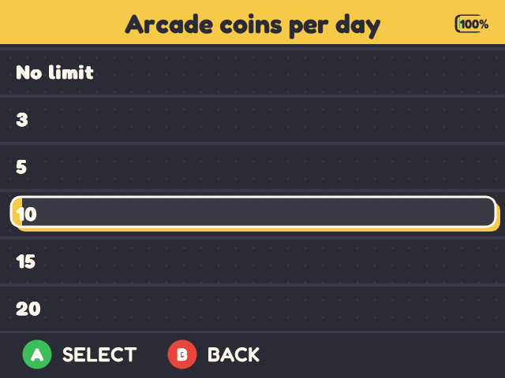
</p>

Or edit `kids/settings.txt` at the root of the card with a text editor. The file is created the first time
KidsOS starts and looks like this:

```
# Arcade coins the kid may insert per day (0 = unlimited).
arcade_coins_per_day=10
# Systems whose games use coins, by folder tag.
arcade_systems=ARCADE,CPS1,CPS2,CPS3,NEOGEO,FBN,FBNEO,MAME
# SSH into the console over Wi-Fi (root, no password, like Onion). 0 turns it off.
ssh=1
```

`arcade_coins_per_day=0` turns coins off: no counter, SELECT always works. The second line is the list of
folders that count as arcade. To hand out today's coins again from the computer, delete `kids/coins.txt`.

## Other settings

Everything else, including the emulator's own menu, is out of the kid's reach. After SELECT + START you can
change brightness, theme music, Wi-Fi and so on in *Apps* › *Tweaks*, like on plain Onion.

Onion's own menu comes in the KidsOS colours too: the *KidsOS by coorasse* theme is installed with the
launcher and switched on the first time. Any other theme picked in Onion's *Themes* app stays.

SSH is on whenever Wi-Fi is on, so the card can be reached from a computer with `ssh root@<ip>` (no password,
as on plain Onion; the IP is shown under *Tweaks* › *Network*). Anyone on your Wi-Fi can do the same, so on a
network you don't trust set `ssh=0` in `kids/settings.txt`. Switching SSH off in *Tweaks* only lasts until
the next power on.

## Updating

Put the card in the computer and run the same command as for the installation:

```bash
curl -fsSL https://raw.githubusercontent.com/coorasse/onionKidsOS/main/install.sh | sh
```

It sees that the card already has KidsOS and offers to update it. Games, saves and favourites stay. It also
asks which version you want, the newest is the default. Put the card back and turn the console on: Onion
updates itself in a minute or two.

By hand: download the new zip, copy the folders onto the card over the old ones (replace when asked), put
the card back and turn the console on.

Don't use Onion's own *OTA update* app. It would install plain Onion and the kids screen would be gone.
Copying a KidsOS zip onto the card brings it back.

## Going back to plain Onion

Download [Onion](https://github.com/OnionUI/Onion/releases), copy its folders onto the card the same way,
and delete the hidden folder `.kidsos`. Games and saves stay.

KidsOS leaves out the parts of Onion that aren't for kids and would make the first start much longer: ScummVM,
the video player, Samba file sharing, the Ports collection, PICO-8, Amiga, EasyRPG, AdvanceMAME and the MAME
arcade emulators. Arcade games run on Final Burn Neo (the `FBNEO` folder). Plain Onion has all of them again.

## Troubleshooting

- **Onion's boot picture instead of the KidsOS one.** Harmless, the kids screen still comes up. Onion's *Reset
  theme overrides* does this; the next power on puts the KidsOS picture back.
- **Black screen, nothing reacts.** Hold **POWER** until the console is off, then turn it on again.
- **The kids screen is empty.** No favourites yet, see [Add games](#3-add-games).
- **The console starts into Onion's menu.** Run the installer again and choose to update the card, see
  [Updating](#updating).
- **A game has no picture.** Check that Wi-Fi is on and that the file is named after the game.
  `.kidsos/covers.log` on the card says what was tried.
- **A game doesn't start.** Try it from Onion's menu (SELECT + START). If it doesn't start there either,
  the problem is the game file or the emulator, not KidsOS.

## How it works

KidsOS adds a small launcher to Onion's package and a boot hook that puts it in front of Onion's menu.
Onion's own scripts stay as they are, except that its installer skips the guide and the Package Manager at
the first start. Onion keeps working as documented, and copying a new KidsOS zip onto the card always brings
the kids screen back.

Build instructions and the development setup are in [docs/DEVELOPMENT.md](docs/DEVELOPMENT.md).

KidsOS is free software under the [GPL-3.0](LICENSE), like Onion. It has nothing to do with Miyoo or the
Onion team.
